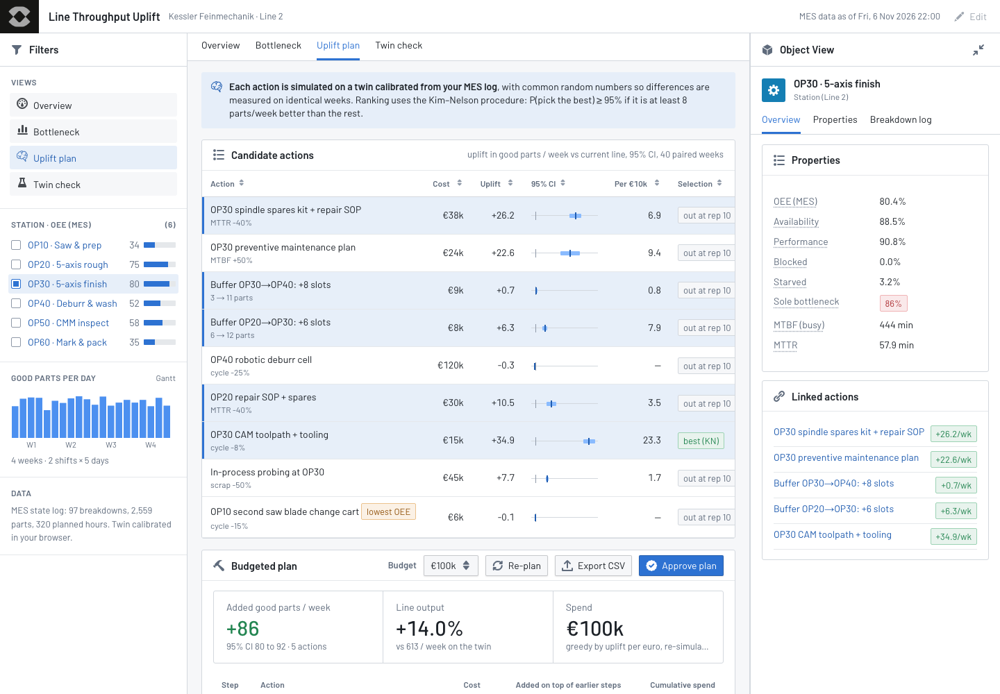

# Line Throughput Uplift (concept Workshop app for Onodrim)

**Live demo:** https://mohith26.github.io/onodrim-throughput-uplift/ · unofficial concept by Mohith Gajjela, not affiliated with Onodrim.

Onodrim buys specialist European manufacturers and sends Forward Deployed Operators and Engineers into their plants to "diagnose why a line underperforms" with "OEE and loss analysis, bottleneck and flow mapping" and then prove impact ([FDO Production Engineering](https://apply.workable.com/j/0030F55907), [FDE Software Engineering](https://apply.workable.com/j/FE11FA65ED) posts). This app turns a plant's MES state log into a decision: it calibrates a digital twin of the line from the log, finds the station that actually limits output (which is usually not the one with the worst OEE), and picks the improvement plan that adds the most good parts per euro, with a statistical guarantee on the ranking. On a synthetic 6-station machining line, a **€100k plan adds 86 good parts a week (+14%, 95% CI 80-92)**, while speeding up the lowest-OEE station adds nothing.



## What it does

1. **Overview.** OEE per station the way an MES dashboard reports it, next to what actually happens: running, down, blocked, starved, and the share of time each station is the line's bottleneck. In the demo the saw (OP10) has the worst OEE (34%) only because it is blocked 59% of the time; OP30 (5-axis finish) is the sole bottleneck 86% of the time.
2. **Bottleneck.** A Gantt of station states for any of the 20 production days with the momentary bottleneck underneath (active period method), and a daily chart of how the bottleneck shifts.
3. **Uplift plan.** Nine candidate actions (spares kits, preventive maintenance, buffer racks, CAM/tooling, a deburr robot, in-process probing) simulated on the twin with paired weeks. Kim-Nelson ranking and selection picks the best single action; a budgeted greedy plan re-simulates on top of each chosen step so interactions and bottleneck shifts are captured. Change the budget, re-plan live in the browser, approve the plan (creates work orders, persisted), export CSV.
4. **Twin check.** Calibrated parameters with confidence intervals, simulated vs observed weekly output, and a hold-out check of the plan against the hidden line that generated the log.
5. **Object view.** Click any station or action for its properties, linked actions and breakdown log. Deep links: `#/plan?station=OP30`, `#/bottleneck?day=7`, `#/overview?station=OP10&ov=failures`. Sortable tables (keyboard accessible).

## How it works

- **Line model** ([`src/line.js`](src/line.js)): exact tandem-line recursion with finite buffers and blocking-after-service. Part n starts at station i when it has left station i-1 and station i is free; it leaves when the buffer downstream has room (part n-B-1 has entered station i+1). Failures are operation-dependent (exponential busy time between failures), repairs exponential, cycles lognormal. Each station has its own random streams for cycles and failures, so scenarios share **common random numbers**: an action that changes nothing has exactly zero measured uplift (tested).
- **Calibration**: maximum-likelihood MTBF (busy minutes / breakdowns) with a χ² confidence interval, mean repair time, lognormal cycle mean and CV, all computed in the browser from the MES export.
- **Bottleneck detection**: the active period method (Roser, Nakano & Tanaka, 2001): a station is active while running or down; at each moment the one with the longest ongoing active period limits the line.
- **Ranking and selection**: the Kim-Nelson (2001) fully sequential procedure. It guarantees P(select the best) ≥ 1-α when the best action is at least δ parts/week better than the rest (α = 5%, δ = 8). A randomized test checks the guarantee empirically.
- **Plan**: greedy by uplift per €10k, re-simulated at every step on top of what is already chosen, keeping only steps whose 95% lower bound is positive.

## Results (`node scripts/generate.mjs`, seeded, deterministic)

| | Value |
|---|---|
| Observed good parts / week (4-week log) | 594, 636, 597, 588 (mean 604) |
| Twin, 40 simulated weeks | 613 (sd 35), +1.5% vs observed |
| Constraint (active period) | OP30, sole bottleneck 86% of planned time |
| Lowest OEE | OP10 saw, 33.7% (blocked, not slow) |
| Best single action (KN, α = 5%, δ = 8) | A7 OP30 CAM toolpath + tooling, +34.9 parts/week, €15k |
| Speeding up the lowest-OEE station by 15% | -0.1 parts/week (95% CI -0.2 to 0.1) |
| €120k robotic deburr cell (visibly slow station) | -0.3 parts/week (CI -0.7 to 0.1) |
| **€100k plan** (A7, A4, A1, A6, A3) | **+85.7 parts/week, +14.0% (CI 79.8-91.6)** |
| Same plan on the hidden true line (fresh weeks) | +98.5 parts/week, +16.9% (CI 92.9-104.0) |

## Tests

```
node --test tests/*.test.mjs   # 13 tests, ~1.5 s
```

Deterministic line throughput equals the slowest station's rate; state accounting sums to planned time; flow conservation and buffer limits hold (randomized buffers); MLE calibration recovers the true parameters from a long log; the active period method finds a planted bottleneck; CRN gives exactly zero uplift for a no-op; speeding the bottleneck beats speeding a non-bottleneck; KN achieves its probability of correct selection under the least-favourable configuration (randomized, 150 trials); normal/χ² quantiles; budget respected with positive lower bounds; the headline numbers reproduce exactly from the seeded pipeline; CSV escaping. CI: `.github/workflows/test.yml`.

## Limitations (honest)

- **Synthetic plant.** The line, its parameters, costs and the 4-week MES log are generated from seeded assumptions (`src/config.js`), not from a real Onodrim portfolio company (none are public yet). Real use would ingest an MES/ERP export (state changes per machine, part counts, scrap).
- **Serial line only.** Parallel machines, batch processes (anodizing, heat treatment), rework loops, shift patterns and changeovers are not modelled. Scrap is applied at the end of the line.
- **4 weeks is short.** OP30 had 38 breakdowns in the window; the MTBF interval is wide. In the hold-out check the twin under-predicted the plan's real effect (+86 vs +98) because the log period understated how often OP30 fails. Good parts in the log ran about 3.5% above the hidden line's long-run average.
- **Costs and effect sizes of actions are assumptions** (e.g. "spares kit cuts MTTR 40%"). The app ranks actions given those assumptions; the effect sizes should come from the FDO's floor assessment.
- **OEE convention.** Performance here counts starved and blocked time as loss, as many MES dashboards do; that is exactly why the lowest-OEE station can have spare capacity.
- The Workshop look is rebuilt with Blueprint (the open-source design system Workshop uses) and public Palantir docs screenshots; this is not a Foundry deployment.

## Prior art and what is new

Throughput bottleneck detection (active period method, turning-point and arrow-based methods from Li & Meerkov's production systems engineering), DES digital twins (Simio, FlexSim, AnyLogic), and ranking & selection (Kim-Nelson, Rinott) are established. Commercial "bottleneck analysis" exists in some MES/analytics products. The contribution here is packaging them into the workflow Onodrim's job posts describe: from a raw MES log to a costed, statistically ranked improvement plan that a Forward Deployed Operator can take to a plant director, inside the Foundry Workshop environment they already deploy. I found no public Onodrim product (the company has not announced an acquisition yet), so this is new for them by construction.

## Run locally

```
python3 -m http.server   # open http://localhost:8000
node scripts/generate.mjs   # regenerate data/mes.json and data/results.json (<1 s)
```

Static HTML/CSS/JS, no build step. Blueprint CSS from unpkg, Barlow from Google Fonts.
